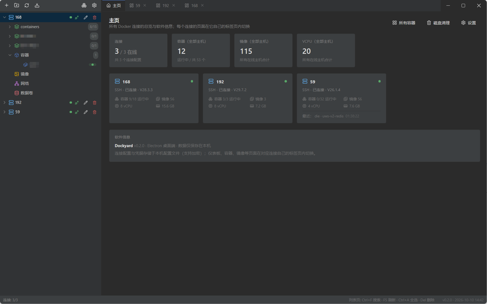
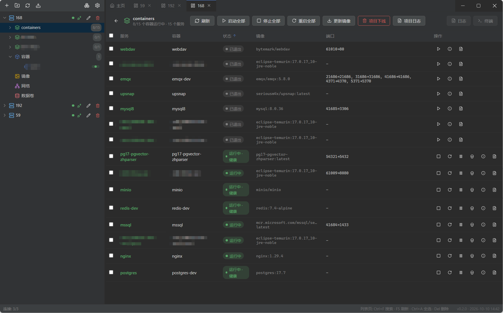
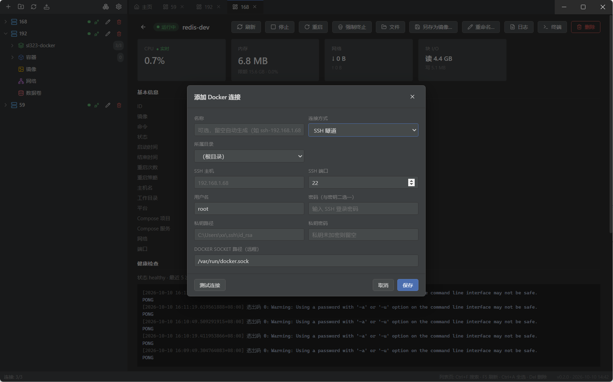
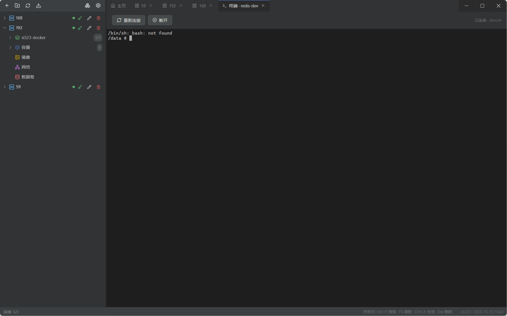
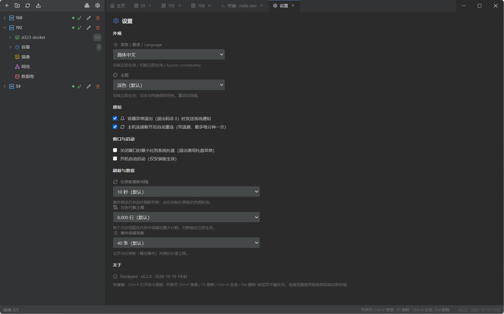

# Dockyard

> An open-source, multi-host Docker manager built with Electron + React.

[](https://github.com/kinghackers/dockyard/actions/workflows/ci.yml)
[](https://github.com/kinghackers/dockyard/actions/workflows/release.yml)

- Primary repo (Gitee): <https://gitee.com/kinghackers/dockyard>
- GitHub mirror: <https://github.com/kinghackers/dockyard>

[Features](#features) · [Quick Start](#quick-start) · [Connection Modes](#connection-modes) · [Development](#development) · [License](#license)

---

## Features

- **Unified multi-host management**: view containers, images, volumes, networks and Compose projects across many hosts in one place.
- **Multiple connection modes**: TCP (optional TLS), SSH tunnel, or the local Docker socket.
- **Full container lifecycle**: start / stop / restart / remove / rename, terminal, logs (filter & regex), file browser (upload / download).
- **Image operations**: pull, import from tar, tag, push, layer history, prune.
- **Polished lists**: relative timestamps (exact time on hover), filter match count, one-click clear, right-aligned numeric columns, ellipsis for long text.
- **Internationalized**: Simplified Chinese / Traditional Chinese / English.

## Screenshots

| Screen | Description |
| --- | --- |
|  | Multi-host overview and resource stats |
|  | Container list, filtering and bulk actions |
|  | Add / edit Docker connection (TCP / SSH / socket) |
|  | Container terminal and logs |
|  | Preferences and about |

> Drop screenshots into `docs/screenshots/` (PNG, ~1280×800). Placeholder for now — real images to be added.

## Quick Start

### Download a release

Go to [GitHub Releases](https://github.com/kinghackers/dockyard/releases) (or [Gitee Releases](https://gitee.com/kinghackers/dockyard/releases)) and download the Windows installer (`Dockyard-x.y.z-Setup.exe`).

### Windows install note

Dockyard installers are **not currently code-signed** (see [Code Signing Policy](#code-signing-policy) below). Windows therefore shows a security prompt on first run — this is expected and does not mean the file is broken. Pick your case:

| Prompt | Looks like | What to do |
| --- | --- | --- |
| **SmartScreen** (blue dialog, has buttons) | "Windows protected your PC" | Click **More info** → **Run anyway**. |
| **Smart App Control (SAC)** (hard block, no override) | "This app has been blocked for your protection" | SAC decides on cloud reputation — **unsigned means blocked**, and "right-click → Unblock" does **not** help it. The only no-cost workaround is to **turn it off temporarily**: **Windows Security → App & browser control → Smart App Control settings → Off**, install, then **turn it back on** (freely toggleable since the April 2026 update KB5083769; on older builds the switch is one-way). |

> On macOS Gatekeeper shows "unidentified developer". Depending on your macOS version either right-click → **Open**, or open **System Settings → Privacy & Security** and choose **Open Anyway**.
>
> If you would rather not rely on any trust verdict, build from source instead — every build definition is public and auditable (next section).

### One-line install (Windows, recommended)

Rather not deal with the prompts by hand? Run this one line in PowerShell (admin or not) to auto-download and launch the installer (it clears Mark-of-the-Web to soften the SmartScreen prompt):

```powershell
irm https://raw.githubusercontent.com/kinghackers/dockyard/master/install.ps1 | iex
```

> This script only simplifies the **SmartScreen** flow. If the device has **SAC** enabled, the unsigned installer will still be hard-blocked — turn SAC off temporarily first (see above).

### Build from source

```bash
# Primary repo (Gitee)
git clone https://gitee.com/kinghackers/dockyard.git dockyard
# Or use the GitHub mirror
git clone https://github.com/kinghackers/dockyard.git dockyard
cd dockyard
npm ci
npm run dev      # Launch dev window (Vite + Electron)
npm run dist     # Package the Windows NSIS installer (pushing a v* tag to GitHub triggers the automated release)
```

> If `npm run dist` fails on Windows (e.g. `app.asar` locked), use `npm run dist:compat`.

## Connection Modes

| Mode | Description |
| --- | --- |
| TCP | Plain or TLS-encrypted TCP to the daemon port. |
| SSH tunnel | Tunnel through SSH; credentials are encrypted at rest locally. |
| Local socket | The local Docker socket (Windows named pipe / Linux, macOS Unix socket). |

## Tech stack

- **Electron** + **React 18** + **Vite 5** + **TypeScript**
- **dockerode** — Docker Engine API client
- **ssh2** — SSH tunnel
- **zustand** — state management
- **lucide-react** — icons
- **OpenCC** — Simplified → Traditional Chinese conversion
- **vitest** — unit / smoke tests

## Development

See [CONTRIBUTING.md](./CONTRIBUTING.md). App source lives in `src/`, the Electron main process in `electron/`, and build scripts at the repo root. Common commands:

| Command | Purpose |
| --- | --- |
| `npm run dev` | Launch dev (Vite + Electron) |
| `npm run test` | Unit tests (vitest) |
| `npm run e2e` | Smoke test against a mock daemon |
| `npm run verify` | Full verify (typecheck + tests + IPC/logic + e2e) |

## Security

Connection credentials are stored encrypted on the local machine; exports can strip secrets. See [SECURITY.md](./SECURITY.md).

### Code Signing Policy

- Dockyard releases are built automatically by GitHub Actions from tagged commits of this repository; all build definitions live in this repository and are publicly auditable.
- Signed artifacts, when available, are published exclusively as assets of the corresponding GitHub Release (tag); this is the only distribution channel covered by this policy.
- **Current status: unsigned.** This is a single-maintainer project. It applied to [SignPath Foundation](https://signpath.org) for free open-source code signing and was declined; commercial certificates are not currently feasible. Because releases are unsigned, Windows may show SmartScreen warnings or Smart App Control blocks — see [Windows install note](#windows-install-note) for how to proceed. Until then, the strongest guarantee offered is that every artifact is reproducible from the public repository: build from source and compare.
- If code signing becomes available, this section will be updated and the release notes for that version will announce it.
- The maintainer acts as Author, Reviewer, and Approver, with multi-factor authentication enabled on the distribution accounts.

## Roadmap

- Multi-platform release: the release workflow now builds Windows / macOS (dmg+zip, x64+arm64) / Linux (AppImage+deb) automatically (`.github/workflows/release.yml`, tag-triggered)
- Code signing: eliminate the Windows SmartScreen / macOS Gatekeeper warnings (options & integration guide: [docs/CODE_SIGNING.md](docs/CODE_SIGNING.md))
- Live per-container metrics charts
- Broader registry integrations

## License

Released under the [MIT License](./LICENSE).

## Trademark

"Docker" is a trademark of Docker, Inc. This project is not affiliated with or endorsed by Docker, Inc.
